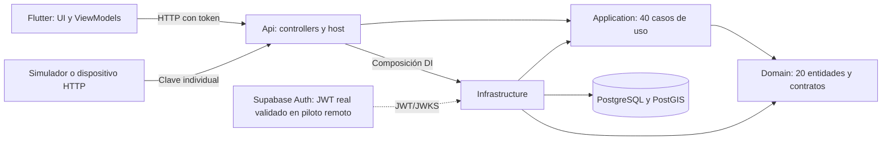
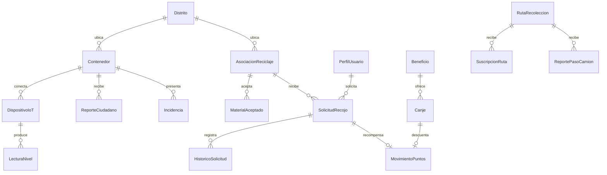

# Arquitectura implementada · 0.2

Monolito modular C# y cliente Flutter independiente. No se despliegan microservicios: todavía no existe una necesidad operativa que justifique sus costos de coordinación y consistencia.

Domain no importa EF ni ASP.NET. Application usa DTOs/contratos de servicios y clases concretas por operación con ExecuteAsync. Infrastructure implementa repositorios LINQ, UnitOfWork, contexto EF, identidad, middleware y worker. Api conserva Controllers/Program como cuarta capa del curso. Prueba automática comprueba referencias entre proyectos.

## Modelo persistido

| Área | Entidades reales |
|---|---|
| Comunidad | Distrito, PerfilUsuario, AsociacionReciclaje, MaterialAceptado, PuntoAcopio |
| Recojo | SolicitudRecojo, HistoricoSolicitud |
| Sensores y atención | Contenedor, DispositivoIoT, LecturaNivel, ReporteCiudadano, Incidencia |
| Horarios | RutaRecoleccion, SuscripcionRuta, ReportePasoCamion |
| Recompensas | MovimientoPuntos, Beneficio, Canje |
| Comunicación y control | Notificacion, EventoAuditoria |
| Reglas y tipos auxiliares en archivos propios de Entities | Ubicacion, PoliticaRecompensas, EstadoIncidencia, TipoAviso |

**Nota de conteo:** hay 24 archivos en Entities; 20 contienen entidades persistidas. Ubicacion y PoliticaRecompensas son reglas estáticas; EstadoIncidencia y TipoAviso son enums. Otros enums acompañan SolicitudRecojo. No deben contarse como tablas ni inventarse entidades para aumentar el tamaño.

Relaciones conceptuales: no todas las asociaciones a identidad externa son FKs hacia auth.users. El UUID autenticado es la identidad del actor; los perfiles de negocio son locales. No se usa el SDK Supabase dentro de Domain/Application.

## Consistencia y límites

- Una llamada a SaveChanges guarda operación, movimientos, avisos e historial relacionados en una transacción EF/PostgreSQL. Auditoría se añade antes de guardar y registra nombres de campos, sin copiar sus valores personales.
- Claves únicas impiden repetir origen de puntos, canjes de la misma intención, secuencias IoT, suscripciones o eventos de notificación.
- Versiones de solicitud, aliado, perfil, beneficio y otros agregados detectan carreras. Conflicto devuelve 409: consultar estado y repetir la misma intención; no generar otra clave para el mismo canje.
- El perfil se carga antes de calcular puntos diarios para que dos confirmaciones simultáneas no eludan el tope. Día/racha usa Perú UTC−5.
- Geography calculada e índice GiST evitan dependencias espaciales en Domain. Distancia/radio se resuelven en PostgreSQL para contenedores y candidatos; catálogos de acopios se acotan antes de filtrar, limitación documentada para crecimiento.
- Lecturas antiguas no sustituyen el nivel actual. Falta de datos se presenta como desconocido, nunca como contenedor vacío.
- Recordatorios persisten próximo vencimiento y claves de evento; son avisos internos. No hay aún outbox con garantías de entrega de un proveedor push.
- INotificadorUsuarioService aplica pausa y preferencias del destinatario dentro de la unidad de trabajo actual. Las pantallas no deciden qué avisos se persisten; operaciones e historial siguen disponibles si se silencian.

## Cliente

Riverpod compone repositorios y ViewModels, Dio maneja transporte y go_router el acceso a pantallas. El servidor sigue siendo la autoridad de permisos, stock y puntos. Caché opcional del mapa público separada por servidor; tokens Auth en secure storage. No se cachean códigos de entrega ni domicilios. Animaciones reducidas, navegación accesible y estados de error/vacío/carga son parte de la UI.

El modelo objetivo anterior conserva ideas futuras (EntregaDetalle, depósito, instituciones, Storage/push). Su presencia en un diagrama objetivo no implica implementación: [matriz actual](MATRIZ_COBERTURA.md).
