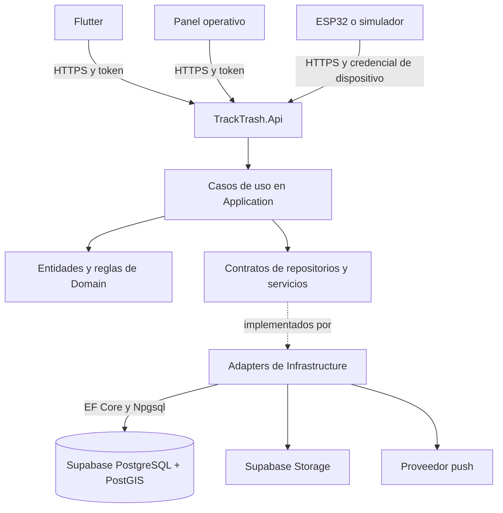
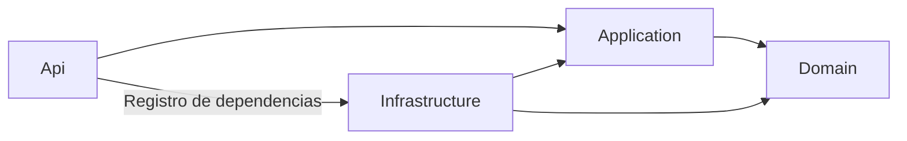

# Arquitectura de TrackTrash adaptada al curso

Arquitectura objetivo documentada a partir del resumen de la clase, la imagen local `Clearanquitectureimg.jpg` y la preferencia por Supabase. Se conserva como antecedente: la estructura realmente disponible del incremento 0.2 está en [ARQUITECTURA_IMPLEMENTADA.md](ARQUITECTURA_IMPLEMENTADA.md), y el estado de cada requisito en [MATRIZ_COBERTURA.md](MATRIZ_COBERTURA.md).

## 1. Interpretación de las referencias

La imagen define Domain, Applications, Infrastructure y API. Usaremos `Application` en singular como nombre consistente de proyecto; puede renombrarse si el laboratorio exige el plural literal.

| Punto | Decisión para TrackTrash |
|---|---|
| Controllers | En Api, como muestra la imagen; el resumen los sitúa en Infrastructure y es contradictorio |
| Entidades y contratos de persistencia | En Domain, siguiendo el resumen y la imagen |
| Unit of Work | Interfaz IUnitOfWork en Domain; implementación UnitOfWork en Infrastructure |
| Casos de uso | En Application, una clase por acción y un método público ExecuteAsync, sin interfaz por caso de uso |
| DTOs de los casos de uso | En Application, como indica la imagen |
| Servicios externos | Interfaz en Application cuando la necesita un caso de uso; implementación en Infrastructure |
| Reglas del dominio | Implementaciones en Domain, además de entidades y contratos |
| Middleware y DI | Implementaciones y registros centralizados en Infrastructure; activación y orden del pipeline en Program.cs |
| Cuarta capa | Proyecto ejecutable ASP.NET Core Web API con Controllers y Program.cs |

La frase «todo el código concreto va en infrastructure» no se aplica literalmente: ConfirmarEntregaUseCase es código concreto de Application y Entrega.Confirmar es código concreto de Domain. Infrastructure implementa los detalles técnicos y los contratos de acceso a recursos externos.

Clean Architecture y arquitectura hexagonal comparten la inversión de dependencias, pero no son nombres de una plantilla universal de tres o cuatro proyectos. La ubicación de interfaces puede variar entre diseños. En este proyecto se mantiene la convención de repositorios en Domain requerida por el curso.

Una carpeta por funcionalidad no constituye un microservicio. Esta solución es un monolito modular con un despliegue inicial. Separar servicios más adelante exige analizar datos, contratos, despliegue, consistencia y operación; las capas solo ayudan a mantener responsabilidades claras.

## 2. Componentes del sistema



El diagrama anterior describe el recorrido lógico de ejecución. Las referencias de compilación son diferentes:



Domain no depende de ninguna otra capa del proyecto. Application no referencia Infrastructure, ASP.NET Core, EF Core ni el SDK de Supabase. Api conoce Infrastructure para configurar la aplicación; sus controladores consumen casos de uso. Esta referencia desde el host para componer dependencias es compatible con el enfoque documentado por [Microsoft](https://learn.microsoft.com/en-us/dotnet/architecture/modern-web-apps-azure/common-web-application-architectures).

## 3. Estructura propuesta

```text
tracktrash-backend/
  TrackTrash.sln
  src/
    TrackTrash.Domain/
      Entities/
        Entrega.cs
        SolicitudRecojo.cs
        Contenedor.cs
        MovimientoPuntos.cs
      ValueObjects/
      Enums/
      Exceptions/
      Rules/
        PoliticaPuntos.cs
      Ports/
        Repositories/
          IEntregaRepository.cs
          ISolicitudRecojoRepository.cs
          IMovimientoPuntosRepository.cs
          IEventoPendienteRepository.cs
        Persistence/
          IUnitOfWork.cs

    TrackTrash.Application/
      UseCases/
        SolicitudesRecojo/
          CrearSolicitudRecojoUseCase.cs
          AceptarSolicitudRecojoUseCase.cs
          CancelarSolicitudRecojoUseCase.cs
          ObtenerSolicitudRecojoPorIdUseCase.cs
        Entregas/
          ConfirmarEntregaUseCase.cs
        Contenedores/
          ObtenerContenedoresCercanosUseCase.cs
          RegistrarLecturaContenedorUseCase.cs
        Incidencias/
          CrearIncidenciaUseCase.cs
      DTOs/
        SolicitudesRecojo/
        Entregas/
        Contenedores/
      Ports/
        Services/
          IArchivoService.cs
          INotificacionService.cs
          IUsuarioActualService.cs
          IFechaHoraService.cs

    TrackTrash.Infrastructure/
      Persistence/
        TrackTrashDbContext.cs
        Configurations/
          EntregaConfiguration.cs
        Repositories/
          EntregaRepository.cs
          SolicitudRecojoRepository.cs
          MovimientoPuntosRepository.cs
          EventoPendienteRepository.cs
        UnitOfWork.cs
        Migrations/                 # si se elige EF para gestionar el esquema
      Adapters/
        Storage/
          SupabaseArchivoService.cs
        Notifications/
          FirebaseNotificacionService.cs
        Identity/
          UsuarioActualService.cs
        Time/
          FechaHoraService.cs
      BackgroundJobs/
        ProcesarEventosPendientesJob.cs
      Middlewares/
        ExceptionHandlingMiddleware.cs
      Configuration/
        DependencyInjection.cs
        SupabaseOptions.cs

    TrackTrash.Api/
      Controllers/
        SolicitudesRecojoController.cs
        EntregasController.cs
        ContenedoresController.cs
        IncidenciasController.cs
      Configuration/
      Properties/
      Program.cs
      appsettings.json

  tests/
    TrackTrash.Domain.Tests/
    TrackTrash.Application.Tests/
    TrackTrash.Infrastructure.IntegrationTests/
    TrackTrash.Api.IntegrationTests/
```

Es una estructura objetivo: el incremento inicial implementa el subconjunto de solicitudes, entregas y puntos. Se añadirán componentes cuando su funcionalidad lo necesite. Los nombres de acciones y entidades se mantienen en español, con PascalCase y sufijo UseCase: CrearSolicitudRecojoUseCase, no una mezcla de AddSolicitud y RegistrarPickup.

Flutter conserva su propia organización en el repositorio `tracktrash-mobile`; no importa ensamblados C#. Se comunica mediante el contrato HTTP de la API.

## 4. Reglas de ubicación

### Domain

Entidad Entrega: controla transiciones válidas, por ejemplo impedir confirmar una entrega cancelada. PoliticaPuntos: determina los puntos de una entrega válida. Repositorios: expresan necesidades del negocio sin exponer DbContext, DbSet, tipos HTTP o SDK externos.

IUnitOfWork expresa la operación de persistir cambios coordinados sin exponer transacciones de Npgsql. Si hay reglas que necesitan un contrato de dominio, se ubica aquí. El dominio no envía correos ni configura JWT.

### Application

Orquesta el caso de uso: obtiene al actor, verifica su permiso sobre la entrega, carga los datos, invoca las reglas, registra los movimientos y persiste el resultado. No reproduce reglas ya garantizadas por las entidades.

Cada caso de uso recibe por constructor solo las dependencias necesarias y expone ExecuteAsync, con DTO de entrada cuando corresponda y CancellationToken. Se registra como clase concreta; no requiere IConfirmarEntregaUseCase ni un mediador para funcionar.

Los DTOs de entrada/salida pertenecen aquí. Los contratos específicos del transporte HTTP, si aparecen, pertenecen a Api; los formatos propios de Supabase o Firebase pertenecen a Infrastructure. No se añaden DTOs HTTP a Domain.

### Infrastructure

Implementa repositorios con EF Core/LINQ y materializa los resultados antes de devolverlos. No expone IQueryable para que Application arme consultas dependientes de EF. Implementa el almacenamiento de fotos, notificaciones, acceso a identidad del request y reloj del sistema.

Todas las implementaciones de repositorios que participan en una operación comparten el mismo TrackTrashDbContext scoped. UnitOfWork coordina SaveChangesAsync; se agregan transacciones explícitas cuando la operación las necesita. EF Core ya aporta seguimiento de cambios y comportamiento de unidad de trabajo; la interfaz explícita permite cumplir la convención del curso. [DbContext y unidad de trabajo](https://learn.microsoft.com/en-us/ef/core/dbcontext-configuration/).

### Api

El controlador recibe HTTP, invoca un caso de uso y convierte su resultado en respuesta. No contiene reglas de puntos ni consulta directamente tablas. Program configura el host, llama a AddInfrastructure para los registros centralizados, activa middleware en orden y mapea controladores.

El registro centralizado puede registrar también las clases de Application porque Infrastructure la referencia; esto no crea una referencia inversa. Api conserva configuración de host, rutas, OpenAPI y pipeline. La configuración sensible proviene de secretos o variables de entorno, nunca de valores versionados en appsettings.

## 5. Ejemplo: confirmar entrega sin duplicar puntos

1. Flutter llama a `POST /api/v1/entregas/{id}/confirmacion`, enviando el código de entrega y una clave de idempotencia.
2. La autenticación valida el token; el controlador recibe la solicitud.
3. ConfirmarEntregaUseCase comprueba el actor y sus permisos sobre esa entrega, el código y el estado actual. El actor se obtiene de la identidad validada, no de un usuario_id confiado del cuerpo.
4. Entrega.Confirmar aplica las reglas de transición; PoliticaPuntos calcula la recompensa.
5. Los repositorios preparan el cambio de estado, un MovimientoPuntos y un evento pendiente de notificación.
6. UnitOfWork persiste los cambios de BD de forma atómica. Restricciones únicas e implementación de concurrencia evitan la doble confirmación y duplicación de puntos; UnitOfWork por sí solo no evita esas carreras.
7. Un proceso de Infrastructure envía la notificación después del commit y registra intentos. Una llamada de red no forma parte de la transacción PostgreSQL.
8. Api devuelve el resultado al teléfono; una repetición válida devuelve el resultado previo sin volver a otorgar puntos.

Pruebas principales: transiciones inválidas, usuario no autorizado, código incorrecto, confirmaciones simultáneas, repetición por mala red, rollback y reintento de notificación.

## 6. Supabase y autenticación

Supabase aporta PostgreSQL/PostGIS y Storage a esta propuesta. El backend usa EF Core + Npgsql sobre una conexión PostgreSQL apropiada para el entorno y su pool; no necesita pasar por la API REST de Supabase para consultar las tablas. [Conexión a PostgreSQL](https://supabase.com/docs/guides/database/connecting-to-postgres), [PostGIS](https://supabase.com/docs/guides/database/extensions/postgis), [Npgsql](https://www.npgsql.org/efcore/).

Para fotos, IArchivoService se implementa mediante un adapter de Supabase Storage, con buckets privados y accesos autorizados. [Storage](https://supabase.com/docs/guides/storage).

Auth sigue pendiente de la rúbrica:

- Si se permite autenticación gestionada: Supabase Auth emite tokens, Flutter inicia sesión y Api verifica firma, emisor, audiencia, vigencia y permisos. La relación con el usuario de negocio se mantiene en nuestras tablas.
- Si el curso exige desarrollar identidad y emisión JWT en C#: se usa una implementación propia con componentes de ASP.NET Core; Supabase se mantiene como BD y Storage.

Elegir una autoridad de identidad para la primera versión. No duplicar contraseñas y flujos de recuperación en ambos sistemas. [Tokens de Supabase](https://supabase.com/docs/guides/auth/jwts).

La conexión SQL de EF no hereda automáticamente el contexto del usuario autenticado ni las políticas basadas en auth.uid(). Aplicar autorización por recurso y organización en API/casos de uso, usar credenciales de BD con privilegios mínimos y configurar la exposición de tablas y RLS según el acceso elegido. Ninguna credencial de BD ni clave administrativa se incluye en Flutter.

Supabase Realtime es opcional para actualizaciones a clientes conectados; no sustituye las notificaciones push con la app cerrada. Evitar implementar Realtime y SignalR para la misma necesidad sin justificación. Las reglas de negocio siguen pasando por los casos de uso C#.

La API ASP.NET Core necesita su propio alojamiento; usar Supabase como proveedor no la despliega automáticamente.

## 7. Scaffolding y control del esquema

Hay que distinguir scaffolding de entidades/DbContext desde la BD y scaffolding de controladores CRUD. Si el laboratorio exige ingeniería inversa, se genera únicamente el esquema/tablas propios de TrackTrash, nunca se incorpora indiscriminadamente auth o storage de Supabase. [Scaffolding de EF Core](https://learn.microsoft.com/en-us/ef/core/managing-schemas/scaffolding).

Para conservar la independencia de Domain, la salida regenerable puede quedar en `Infrastructure/Persistence/Scaffolded` y mapearse a las entidades de Domain. Las clases generadas representan persistencia y no son las entidades del dominio. No poner reglas manuales en archivos que serán sobrescritos. Si el docente exige entidades generadas directamente en Domain, habrá que ajustar la generación para que sean clases puras y ubicar configuraciones de EF en Infrastructure.

Si el curso permite empezar desde código, se pueden escribir entidades puras en Domain, configurarlas mediante Fluent API en Infrastructure y versionar migraciones EF. Se elegirá una autoridad para cambios de esquema: migraciones EF o migraciones SQL controladas; no cambios manuales paralelos sin historial. No se ha elegido ni ejecutado el flujo de scaffolding todavía.

Los controladores CRUD generados que usan DbContext directamente deberán adaptarse para llamar a casos de uso antes de considerarlos parte de esta arquitectura.

## 8. Verificación de la arquitectura al implementar

- Revisar referencias de proyectos para impedir que Domain/Application dependan de Infrastructure o Api.
- Probar reglas en Domain y casos de uso con contratos sustituidos en Application.
- Probar repositorios, transacciones e índices espaciales contra PostgreSQL/PostGIS real.
- Probar endpoints con identidad, permisos, DTOs y errores HTTP.
- Revisar que no haya reglas en controladores ni tipos EF/Supabase filtrados al núcleo.
- Asegurar que middleware, DI, LINQ, scaffolding y UnitOfWork tengan evidencia identificable para el laboratorio.

Pendientes acotados: confirmar si la rúbrica exige el nombre Applications en plural, el tipo de scaffolding y autenticación propia. Esos detalles no impiden adoptar la distribución mostrada en la imagen.
