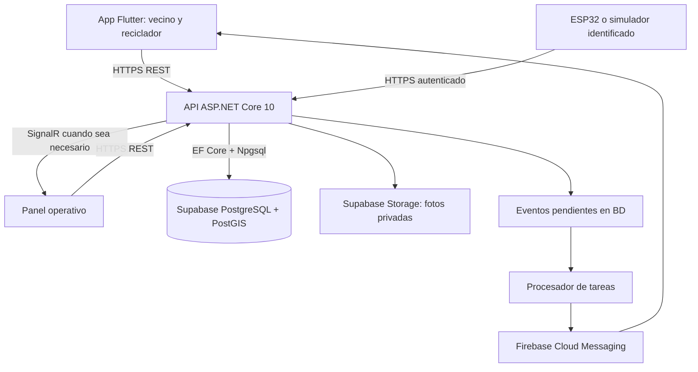

# Plan de desarrollo de TrackTrash

Fecha de investigación inicial: 23 de octubre de 2026. Plan del producto completo conservado como antecedente. Actualización 24/10: el incremento 0.2 amplía el primer flujo; ver [estado de desarrollo](ESTADO_DESARROLLO.md), [arquitectura implementada](ARQUITECTURA_IMPLEMENTADA.md) y [cobertura por requisito](MATRIZ_COBERTURA.md). Las propuestas de este plan no equivalen a funcionalidades terminadas.

## 1. Recomendación

Construir primero una app Android en Flutter, preparada para iOS, conectada a una API ASP.NET Core 10 y PostgreSQL/PostGIS alojado en Supabase. Organizar el backend como monolito modular con cuatro proyectos según la referencia del curso: Domain, Application, Infrastructure y Api. Organizar la app por funcionalidades, con separación entre interfaz, estado, reglas y acceso a datos. Incorporar un panel operativo mínimo y un simulador IoT para demostrar el recorrido completo.

El primer resultado debe ser: un vecino encuentra una opción de reciclaje, solicita un recojo, un reciclador autorizado lo acepta, confirma la entrega con código y el vecino ve su historial y puntos. En paralelo, el mapa muestra contenedores y permite reportar incidencias. Esto permite validar utilidad y operación antes de incorporar predicciones y pagos.

Supuestos pendientes: Android primero; no existe backend fuera de esta carpeta; piloto en una zona de Arequipa; presupuesto y fecha por confirmar. Las estimaciones se revisarán con esas respuestas.

## 2. Evidencia revisada

- `TrackTrash- Informe Emprendimiento.docx`: propuesta B2B2C, actores, modelo de datos, 40 requisitos funcionales y 26 no funcionales; ASP.NET Core/EF Core/PostGIS explícitos.
- `TrackTrash Arequipa.pdf`: 10 páginas; propuesta comercial, pantallas conceptuales, Tacho Vivo y objetivos del piloto.
- `PLAB-S08-CLAZARO-2026-2.docx`: prototipo físico, componentes, estados del sensor, recorrido del vecino y presupuesto de materiales de S/104. Ese importe es del documento, no una cotización vigente ni el costo del sistema completo.
- Inspección visual: pantallas del informe y páginas 3–5 del PDF. Hay una propuesta clara con fondos claros y otra oscura de presentación; falta consolidarlas como sistema de diseño.
- Actualización de arquitectura: resumen de clase aportado por el usuario e imagen local `Clearanquitectureimg.jpg`, leída visualmente. La imagen ubica Controllers en API y DTOs en Application; para esas decisiones se prioriza la imagen frente a las ambigüedades del resumen. Detalle en [ARQUITECTURA_TRACKTRASH.md](ARQUITECTURA_TRACKTRASH.md).

Hallazgos que conviene resolver:

1. El capítulo 2 conserva párrafos sobre una «faja transportadora inteligente» que no corresponden a TrackTrash.
2. Los prototipos incluyen «vender residuos», pero falta definir precio, pagador, liquidación, disputas y comprobantes. No implementar pagos hasta definir ese flujo.
3. Las alertas de camión son una promesa central del recorrido del vecino, pero requieren horarios o posiciones confiables. Separar recordatorio de horario, reporte vecinal y estimación basada en GPS.
4. El modelo enumera personal de institución en los requisitos, pero necesita completar organizaciones, membresías y permisos. Un rol global por usuario no resuelve por sí solo el aislamiento entre instituciones.
5. Un cambio de nivel o apertura de tapa no identifica quién depositó residuos. GPS y proximidad no bastan para certificar la acción ni su peso.
6. «No sacaste la basura» no puede inferirse simplemente de la ausencia de registro. Reformular como «No registraste una entrega hoy», de uso opcional.
7. El presupuesto del hardware no acredita autonomía de 30 días, resistencia ambiental ni compensación térmica. Esas propiedades requieren mediciones y validación física.

## 3. Producto y experiencia móvil

Navegación propuesta: Inicio, Mapa, Recojos, Mi impacto y Perfil. Notificaciones accesibles desde Inicio. La guía de materiales aparece tanto en Inicio como al solicitar un recojo.

| Pantalla o flujo | Contenido y comportamiento |
|---|---|
| Bienvenida y acceso | Registro, inicio, recuperación y explicación breve del servicio; pedir permisos cuando se necesiten |
| Inicio | Próximo recojo, acciones Solicitar/Reportar, estado cercano y progreso personal |
| Mapa y lista equivalente | Filtros para contenedores, puntos de acopio y recicladores; detalle, materiales, horario y última actualización |
| Solicitud | Material y cantidad estimada → ubicación y horario → resumen y confirmación |
| Seguimiento | Pendiente, aceptada, en camino, confirmada o cancelada; contacto operativo y código de entrega |
| Reportar incidencia | Tipo, ubicación, descripción y foto opcional; seguimiento de resolución |
| Mi impacto | Entregas, cantidades estimadas o verificadas diferenciadas, movimientos de puntos |
| Perfil | Dirección de referencia, preferencias, privacidad, ayuda y cierre de sesión |
| Modo reciclador | Solicitudes elegibles, aceptación, cambio de estado y confirmación con código |

Mantener verde oscuro, fondos claros y el personaje Tacho Vivo como acompañamiento. Usar textos legibles, controles accesibles, estados expresados mediante icono y texto además del color, y soporte para texto ampliado. Diseñar carga, vacío, error, permisos denegados y desconexión desde el primer prototipo.

No publicar domicilios ni ubicación precisa de recicladores en el mapa público. Mostrar puntos de servicio y compartir la dirección necesaria solo con los participantes autorizados de una solicitud.

## 4. Alcance por entregas

| Entrega | Incluye | Relación con requisitos |
|---|---|---|
| Base | Acceso, perfil, permisos, organizaciones, preferencias y diseño | RF-01–04; base RNF-08–11, 18–21 |
| MVP de reciclaje | Guía, mapa de aliados, solicitud, asignación por material/zona/capacidad, aceptación, código, historial | RF-18–23; ubicación y materiales verificados |
| MVP de contenedores | Contenedores, reporte ciudadano, incidencias, mapa con antigüedad del dato, ingesta HTTP y simulador | RF-05–10, 16; RF-06–07 y 09 requieren además validación física para declararse IoT real |
| Operación y comunicación | Bandeja, push de recojo, reintentos, deduplicación, panel mínimo de incidencias y entregas | RF-30 parcial, 32–33–34, 35–38; indicadores básicos de RF-37 |
| Puntos iniciales | Libro de movimientos por entregas confirmadas y límites; sin canjes ni premios por depósito no verificable | RF-25–26 parciales y RF-29 |
| Piloto ampliado | Rutas/horarios, reportes de paso, ETA si hay datos, rachas, canjes, organizaciones e informes | RF-11–15, 17, 24–28 restantes, 30–31 restantes, 39 |
| Optimización | Priorización de rutas, integración logística y ampliación de telemetría | RF-40; rendimiento medido antes de ampliar infraestructura |

Esta tabla es una propuesta de recorte del primer lanzamiento, no una declaración de cumplimiento de los 40 requisitos. Se creará una matriz RF → historia → prueba → evidencia de aceptación.

Pagos, comisiones, suscripciones, clasificación por IA y optimización avanzada se dejan para iteraciones posteriores. Si la rúbrica exige camión o hardware en la primera entrega, se reordena el alcance y se identifica de forma visible cualquier simulación.

## 5. Arquitectura



Las operaciones de negocio de la app pasan por la API C#. Las reglas de autorización, asignación, confirmación y puntos se ejecutan en el servidor. Supabase se propone para PostgreSQL/PostGIS y Storage; Auth y Realtime quedan como integraciones opcionales. Auth podría consumirse desde Flutter, con validación del token y autorización en la API. No se ha creado ni configurado un proyecto Supabase.

### App

Separar interfaz y datos siguiendo las recomendaciones de Flutter; usar Riverpod para coordinar estado y dependencias, repositorios para API/caché y casos de uso solo en operaciones con reglas relevantes. Riverpod es una elección propuesta del proyecto, no una obligación de Flutter. [Arquitectura oficial](https://docs.flutter.dev/app-architecture/recommendations).

```text
apps/mobile/lib/
  app/                 # arranque, rutas, tema y configuración
  core/                # HTTP, sesión, errores y utilidades compartidas
  features/
    auth/
    map/
    pickups/
    containers/
    incidents/
    rewards/
    notifications/
  ui/core/             # componentes visuales compartidos
```

Dentro de cada funcionalidad: presentación y datos; dominio cuando la complejidad lo justifique. Evitar llamadas HTTP desde widgets y estado de negocio disperso en pantallas.

### Backend

La estructura acordada para esta propuesta sigue la imagen del curso. Se detalla, con carpetas, referencias y recorrido de una entrega, en [Arquitectura TrackTrash](ARQUITECTURA_TRACKTRASH.md).

| Proyecto | Responsabilidades |
|---|---|
| TrackTrash.Domain | Entidades, reglas, interfaces de repositorios e IUnitOfWork; sin dependencias de EF Core ni Supabase |
| TrackTrash.Application | Casos de uso individuales sin interfaz propia, DTOs e interfaces de servicios utilizados por esos casos de uso |
| TrackTrash.Infrastructure | DbContext, configuraciones EF, repositorios, UnitOfWork, adapters de servicios, middleware y registro de dependencias |
| TrackTrash.Api | Controllers, Program.cs y configuración del host Web API |

Referencias de compilación: Application → Domain; Infrastructure → Application y Domain; Api → Application e Infrastructure para componer dependencias. Domain no referencia las demás capas. Los controladores llaman a casos de uso y no consultan DbContext directamente. Un caso de uso expone ExecuteAsync y se nombra en español de forma consistente, por ejemplo ConfirmarEntregaUseCase.

Esta distribución es la convención seleccionada para el curso, no una definición universal del número de capas de Clean Architecture. Las reglas concretas de dominio y los casos de uso se implementan en sus propias capas; Infrastructure concentra implementaciones técnicas. La regla esencial es que las dependencias apunten hacia el núcleo. [Referencia de Microsoft](https://learn.microsoft.com/en-us/dotnet/architecture/modern-web-apps-azure/common-web-application-architectures).

Un servicio desplegable con módulos de Identidad/Organizaciones, Reciclaje, Contenedores/IoT, Incidencias, Recompensas y Notificaciones. Recolección municipal se añade cuando exista fuente de datos. Endpoints agrupados por funcionalidad; reglas independientes del transporte; EF Core y proveedores externos en infraestructura.

API versionada `/api/v1`, contrato OpenAPI, errores uniformes, validación en servidor, paginación y límites. Una base de datos inicialmente, con propiedad clara de tablas por módulo. No se justifican microservicios ni Kubernetes para el piloto documentado.

Usar .NET 10 LTS con parches soportados. Su ciclo de soporte llega a noviembre de 2028. [Política de soporte](https://dotnet.microsoft.com/en-us/platform/support/policy/dotnet-core).

### Modelo de datos a completar

- Organización y membresías, rol y alcance por recurso; municipio e institución no son equivalentes a un usuario.
- Solicitud/entrega con estados, historial de cambios, material, unidad, cantidad estimada y cantidad confirmada por separado.
- Libro inmutable de puntos con referencia única al evento que los origina.
- Contenedor, dispositivo y lectura con hora de medición y de recepción, secuencia e identificación de origen.
- Reporte ciudadano e incidencia separados de mediciones del sensor; guardar procedencia y vigencia.
- Notificación, intento de entrega y evento pendiente de publicar; no confundir aceptación del proveedor con lectura del usuario.
- Índices geoespaciales GiST y consultas por zona visible/distancia; usar `geography` correctamente desde Npgsql/NetTopologySuite. [Integración espacial](https://www.npgsql.org/efcore/mapping/nts.html).

### Casos que deben resistir fallos

- Dos recicladores intentan aceptar: actualización atómica; solo uno obtiene la asignación.
- El vecino repite una solicitud por mala señal: identificador idempotente y devolución del resultado existente.
- Se confirma dos veces la entrega: transición validada, transacción y evento único; puntos una sola vez.
- La app pierde conexión: guía, últimos datos y borradores locales; envío pendiente visible. La aceptación y confirmación requieren validación del servidor.
- Reinicio después de confirmar una entrega: la notificación sigue pendiente en BD y se reintenta; deduplicación por evento/destinatario/canal y, donde corresponda, en cliente.
- Sesión vencida durante la operación: renovación coordinada y reintento seguro; no duplicar escrituras.
- Un sensor reenvía datos viejos: conservar historial, rechazar duplicados y no reemplazar el estado actual con una lectura anterior.
- Un sensor deja de reportar: estado «sin datos recientes», sin presentar su último color como actual.

## 6. Librerías y servicios candidatos

No se ha probado todavía la compatibilidad conjunta de estos paquetes. Resolver versiones estables compatibles, fijar SDK y lockfiles, revisar licencias y ejecutar una compilación mínima antes de adoptarlos.

| Área | Selección propuesta | Motivo / referencia |
|---|---|---|
| Estado Flutter | flutter_riverpod | Estado asíncrono e inyección; [paquete](https://pub.dev/packages/flutter_riverpod) |
| Navegación | go_router | Rutas y enlaces profundos; [paquete](https://pub.dev/packages/go_router) |
| Red | Dio | Interceptores, cancelación y gestión centralizada de peticiones; [paquete](https://pub.dev/packages/dio) |
| Persistencia local | Drift/SQLite | Caché relacional y borradores; [paquete](https://pub.dev/packages/drift) |
| Mapas | flutter_map | Mapa Flutter con proveedor cartográfico intercambiable; [documentación](https://docs.fleaflet.dev/) |
| Ubicación | geolocator | Permisos y ubicación; [paquete](https://pub.dev/packages/geolocator) |
| Sesión local | flutter_secure_storage | Almacenamiento seguro de credenciales de sesión; [paquete](https://pub.dev/packages/flutter_secure_storage) |
| Push | Firebase Cloud Messaging | Entrega push Android/iOS; [integración Flutter](https://firebase.google.com/docs/cloud-messaging/flutter/get-started) |
| Persistencia servidor | EF Core + Npgsql + NetTopologySuite sobre Supabase PostgreSQL | Repositorios con LINQ, UnitOfWork e índices espaciales |
| Fotos | Supabase Storage | Buckets privados y acceso autorizado desde adapters en Infrastructure |
| Tareas | Procesador persistente; Quartz.NET si se necesitan calendarios | Persistencia y programación; [documentación](https://www.quartz-scheduler.net/) |
| Observabilidad | Sentry Flutter y OpenTelemetry .NET | Errores, métricas y trazas; [Sentry](https://pub.dev/packages/sentry_flutter), [OpenTelemetry](https://opentelemetry.io/docs/languages/dotnet/) |
| Pruebas móviles | flutter_test + integration_test | Componentes y recorridos; [guía](https://docs.flutter.dev/testing/integration-tests) |
| Pruebas API/BD | Pruebas .NET + Testcontainers | Ejecutar PostgreSQL/PostGIS real en integración; [documentación](https://dotnet.testcontainers.org/) |

Panel: comenzar con una interfaz operativa mínima que consuma la misma API; Razor Pages es una opción si el equipo trabaja principalmente en C#, y React/TypeScript si el responsable web ya lo domina. No decidir Next.js únicamente porque aparece como interrogante en el documento.

Mapas: los datos de OpenStreetMap son libres, pero sus servidores públicos no ofrecen SLA ni permiten precargar mapas para uso sin conexión. Elegir proveedor y presupuesto para producción, conservar atribución y configurar la URL del proveedor fuera del código. La caché de datos de negocio no implica mapas disponibles offline. [Política de teselas](https://operations.osmfoundation.org/policies/tiles/).

## 7. Skills, plugins y repositorios

### Inventario verificado

- Skills disponibles en la sesión: imagegen, openai-docs, skill-creator, skill-installer, plugin-management, Sites y Work Pets. No había skills de Flutter o ASP.NET Core instaladas en la carpeta de skills de usuario.
- La caché local también contiene plantillas; su presencia en disco no implica que estén activas como skills en esta sesión.
- Sites puede ayudar con un sitio informativo; Work Pets y Descript no cubren el desarrollo de la app móvil.
- GitHub y Figma aparecen en el catálogo y están sin instalar; se propusieron como integraciones opcionales. La búsqueda pública y el trabajo local no dependen de conectarlos.

### Selección recomendada para la siguiente fase

| Recurso | Uso | Estado |
|---|---|---|
| flutter-apply-architecture-best-practices | Organización de Flutter | Encontrada en repositorio oficial; no instalada |
| flutter-setup-declarative-routing | Navegación | Encontrada; no instalada |
| flutter-build-responsive-layout | Diseño adaptable | Encontrada; no instalada |
| flutter-add-widget-test | Pruebas de componentes | Encontrada; no instalada |
| flutter-add-integration-test | Recorridos completos | Encontrada; no instalada |
| dart-run-static-analysis | Diagnósticos y análisis | Encontrada en el árbol del repositorio; no instalada |
| aspnet-core | API, seguridad y operación .NET | Disponible en catálogo openai/skills; no instalada |
| gh-fix-ci | Diagnóstico de CI | Disponible en catálogo; incorporar cuando exista pipeline |
| sentry | Investigación de errores | Disponible en catálogo; útil al conectar el proyecto de errores |
| playwright | Pruebas del panel web | Disponible; no sustituye pruebas nativas de Flutter |

Fuentes: [Flutter Agent Plugins](https://github.com/flutter/agent-plugins), [catálogo OpenAI](https://github.com/openai/skills/tree/main/skills/.curated). También existe el [MCP de Dart/Flutter](https://docs.flutter.dev/ai/tools), útil para diagnósticos y ejecución durante desarrollo; no está configurado en esta sesión.

La skill `security-best-practices` consultada cubre Python, JavaScript/TypeScript y Go; no debe presentarse como auditoría especializada de C# o Dart. Para esas capas usaremos documentación específica y pruebas de permisos y reglas. [Alcance de la skill](https://github.com/openai/skills/blob/main/skills/.curated/security-best-practices/SKILL.md).

Repositorios revisados y utilidad:

| Repositorio | Qué aprovechar | Precaución |
|---|---|---|
| [flutter/samples](https://github.com/flutter/samples) | Ejemplos oficiales y referencias de implementación | Revisar licencia del ejemplo concreto antes de copiar |
| [VeryGoodOpenSource/very_good_cli](https://github.com/VeryGoodOpenSource/very_good_cli) | Plantillas, convenciones y arranque de proyectos | Adoptar solo lo que encaje con el estado y arquitectura elegidos |
| [jasontaylordev/CleanArchitecture](https://github.com/jasontaylordev/CleanArchitecture) | Separación de capas y organización .NET 10 | Es referencia; evaluar dependencias y licencias, no importar toda la plantilla sin revisar |
| [fleaflet/flutter_map](https://github.com/fleaflet/flutter_map) | Ejemplos y funcionamiento del mapa | El cliente no incluye infraestructura cartográfica gratuita ilimitada |
| [rrousselGit/riverpod](https://github.com/rrousselGit/riverpod) | Estado y pruebas | Mantener una sola estrategia de estado coherente |
| [simolus3/drift](https://github.com/simolus3/drift) | Persistencia y migraciones locales | Probar migraciones y cierre de sesión con limpieza de datos |

Estos repositorios no estaban archivados al consultar GitHub. Actividad y licencia de un repositorio no garantizan ausencia de fallos ni cubren automáticamente sus dependencias. No se clonó ni ejecutó código externo.

Alternativa si el equipo domina React/TypeScript: React Native con Expo tiene [skills oficiales](https://docs.expo.dev/skills/). No cambiaría a ese stack solo por disponer de más skills; primero pesa la experiencia del equipo y el prototipo real de mapas/push.

## 8. Calidad y condiciones de aceptación

No es posible prometer una aplicación sin fallos. Sí se pueden definir comportamientos medibles y bloquear entregas que incumplan recorridos críticos.

| Área | Prueba o condición propuesta |
|---|---|
| Funcionalidad | Registro → solicitud → aceptación → confirmación → historial/puntos completo en Android real |
| Concurrencia | Doble aceptación, doble confirmación, reenvío de sensor y solicitud repetida sin duplicados de negocio |
| Permisos | Un usuario no accede a solicitudes ajenas; una organización no consulta datos privados de otra |
| Seguridad | Recuperación de cuenta, expiración/revocación de sesión, limitación de intentos y claves IoT individuales |
| Fotos | Tamaño/tipo validado, almacenamiento privado, acceso autorizado y eliminación de metadatos de ubicación innecesarios |
| Desconexión | Datos cacheados identificados como antiguos, borradores conservados y reenvíos controlados |
| Rendimiento | Definir p95 menor a 2 s para consulta de mapa con 1.000 contenedores y 100 usuarios concurrentes bajo carga y entorno acordados |
| Push | Medir menos de 60 s desde evento hasta intento de envío al proveedor; medir entrega aparte, sin prometerla si teléfono/red/SO la impiden |
| Disponibilidad | Objetivo documental 99% mensual, medido después de desplegar; no demostrable solo con pruebas previas |
| Recuperación | Backup diario y restauración ensayada; proponer RPO de 24 h y acordar RTO según infraestructura |
| Compatibilidad | Android mínimo del documento sujeto a SDK/plugins; probar en versión mínima y reciente, pantalla pequeña y teléfono de recursos limitados |
| Usabilidad | Flujo entendido por usuarios del piloto, texto ampliado, lector de pantalla y acciones sin depender del color |

CI por cambio: formato/análisis, pruebas de reglas y API, compilación y análisis de dependencias. Antes de cada versión: recorridos móviles, migración de datos, permisos, pruebas de red/permisos denegados y restauración. Guardar evidencias y defectos conocidos.

Usar secretos fuera del repositorio, logs sin tokens/domicilios, conexión HTTPS y autorización por recurso. La ubicación se solicita solo cuando se necesita. Antes del piloto público se revisarán textos de privacidad, retención y obligaciones aplicables con el responsable correspondiente; este plan no afirma cumplimiento legal certificado.

## 9. Secuencia de implementación y entregables

Estimación inicial, no compromiso de fecha: 6–10 semanas de trabajo sostenido del equipo para un MVP integrado; el alcance completo añade iteraciones. La disponibilidad del equipo, las respuestas pendientes y las pruebas físicas pueden cambiarla.

| Fase | Orientación de esfuerzo/calendario | Resultado verificable |
|---|---|---|
| 0. Definición | 2–3 días | Alcance acordado, historias priorizadas, decisiones y matriz de requisitos |
| 1. Diseño | 3–5 días | Sistema visual y flujos navegables, incluidos errores y desconexión |
| 2. Base técnica | 3–5 días | SDK fijado, repositorio, entornos, API/BD, sesión y CI |
| 3. Recorrido vertical | 1–2 semanas | Recojo completo con dos roles, BD real y puntos idempotentes |
| 4. Mapa y contenedores | 1–2 semanas | Aliados, incidencias, caché, lecturas simuladas y estado por antigüedad |
| 5. Operación | Alrededor de 1 semana | Panel mínimo, push, observabilidad, despliegue de prueba y backups |
| 6. Validación | 1–2 semanas | Pruebas en teléfonos, prueba de carga, correcciones y piloto pequeño |
| 7. Ampliación | Tras evidencia del piloto | IoT físico validado, camión/ETA, canjes, instituciones y monetización |

Los rangos se solapan cuando el equipo divide trabajo; no son una promesa de terminar todos los requisitos dentro del MVP.

Distribución adoptada: repositorios independientes `tracktrash-mobile` y `tracktrash-backend`. El segundo contiene `src`, `tests`, scripts de infraestructura local y documentación/contrato API. Panel y firmware se incorporarán en incrementos posteriores, definiendo su repositorio cuando comience su implementación. Distribuir trabajo según las responsabilidades del equipo, con responsable explícito del backend y de revisión/integración.

Primer incremento técnico: app Android conectada a API y BD, login y solicitud con persistencia real, ejecutándose de extremo a extremo. Esto valida la base antes de multiplicar pantallas.

## 10. Infraestructura y costos a definir

Desarrollo: API y PostgreSQL/PostGIS locales en Docker para pruebas reproducibles, datos sintéticos identificados, simulador de sensor y builds de prueba; validar también integraciones con un entorno Supabase de desarrollo. Piloto: alojamiento independiente para la API C#, Supabase PostgreSQL/PostGIS y Storage, respaldo/restauración verificados según el plan contratado, correo transaccional, push y proveedor cartográfico; separar pruebas y producción. Supabase no sustituye el host de ASP.NET Core.

No se cotizaron proveedores ni se contrataron servicios. Preparar un presupuesto con límites de gasto para alojamiento, BD, fotos/transferencia, mapas/geocodificación, correo, monitoreo, dominio y cuentas de distribución. SMS, conectividad IoT y builds iOS pueden añadir costos. Elegir planes cuando se conozcan usuarios activos, fotos, sensores y frecuencia de actualización; no basarse en que una cuota gratuita permanecerá suficiente.

Escalar mediante índices, paginación, consultas por zona, retención de telemetría y tareas persistentes. Separar procesos o servicios solo cuando las métricas justifiquen el costo operativo.

## 11. Entorno local comprobado

- Windows, Flutter 3.41.6 y Dart 3.11.4; el SDK informa una actualización disponible.
- .NET SDK 10.0.401; Node, Git, GitHub CLI y ejecutable Docker disponibles. No se verificó que el motor Docker esté arrancado ni sesiones autenticadas.
- Android Studio y SDK presentes; `flutter doctor` informa licencias pendientes y herramientas Android con versión candidata.
- Ningún Android real o emulador conectado; se detectaron Edge y Windows.
- Chrome no localizado por Flutter; no impide Android. Visual Studio C++ ausente; solo sería necesario si se decide compilar escritorio Windows.
- La versión consultada de `go_router` 18.1.1 exige Flutter >=3.44 y Dart ^3.12; no encaja con el SDK local actual. Resolver actualización controlada o versión compatible antes de crear dependencias.

No actualizar globalmente Flutter ni aceptar licencias como parte de esta investigación. En implementación, fijar una versión estable por proyecto y completar configuración Android. Para compilar y publicar iOS se necesita entorno macOS/Xcode propio o remoto y las cuentas correspondientes. [Guía iOS](https://docs.flutter.dev/deployment/ios).

## 12. Qué puedo realizar y qué necesita el equipo

Puedo implementar la interfaz, API, BD/migraciones, simulador, integración de firmware, pruebas, panel mínimo, CI, contenedores, documentación y correcciones. Puedo preparar despliegues y paquetes de distribución, condicionados a infraestructura y credenciales disponibles. Los avances deben poder reproducirse y explicarse por el equipo.

Necesito del equipo: fecha y rúbrica, tecnologías obligatorias, experiencia y disponibilidad, datos verificables de aliados, definición de monetización, teléfono Android para pruebas, acceso al hardware y validación física. Para servicios externos: cuentas/proyectos, presupuesto y acceso seguro; no compartir secretos en el chat. Publicar en tiendas requiere titularidad, firma y revisión de la plataforma.

Preguntas pendientes prioritarias:

1. ¿Fecha y tipo de primera entrega: prototipo, app funcional con pruebas o piloto real?
2. ¿Flutter/C# son obligatorios o preferidos? ¿Android solo o iOS desde el inicio?
3. ¿Hay repositorio/backend fuera de esta carpeta, ESP32 funcionando, aliados/datos y presupuesto mensual?

Con esas respuestas se ajustará el plan; hay suficiente contexto para definir y construir una primera versión sin inventar datos de operación.
